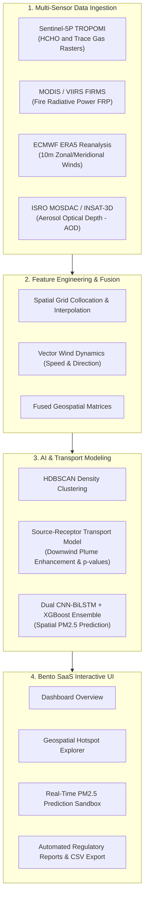

# AirTrace AI: Unified Atmospheric & PM2.5 Spatial Intelligence Platform

[](https://streamlit.io/)
[](https://python.org)
[](https://sentinels.copernicus.eu/)
[](https://scikit-learn.org/)
[](#license)

---

## Overview

**AirTrace AI** is an end-to-end atmospheric remote sensing, geospatial intelligence, and predictive modeling platform designed for environmental regulation boards (CPCB/SPCB), policy analysts, and climate researchers.

It tackles two interconnected environmental challenges across India:
1. **Atmospheric Formaldehyde (HCHO) & Reactive VOC Source Attribution**: Pinpointing true domestic chemical emissions vs. downwind advection using multi-sensor satellite data (Sentinel-5P TROPOMI), active fire radiative power (MODIS/VIIRS FIRMS), and ECMWF ERA5 wind dynamics.
2. **Deep Learning PM2.5 Spatial Prediction Engine**: Spatiotemporal deep learning models (Dual CNN-BiLSTM blend & Gradient Boosted regressors) for high-resolution ground-level PM2.5 forecasting across complex Indian topographies.

---

## Key Features & Modules

### 1. Formaldehyde (HCHO) & VOC Observatory
- **28 Domestic Clustered Regions**: Identifies and ranks domestic Indian source regions across West, Central, North, South, and East zones.
- **Unsupervised Spatial Clustering (HDBSCAN)**: Delineates continuous emission plumes from background noise.
- **Quantitative Source-Receptor Transport Model**: Formulates downwind enhancement ratios, statistical transport significance (p-values), and validation confidence tiers (**Class A**, **Class B**, **Class C**).
- **Interactive Geospatial Visualizer**: Dynamic OpenStreetMap integration with zoomable cluster points, wind roses, and plume dispersion metrics.

### 2. AI PM2.5 Spatial Prediction Engine
- **Multi-Sensor Fusion**: Integrates Sentinel-5P tropospheric columns, INSAT-3D / MOSDAC Aerosol Optical Depth (AOD), and ERA5 boundary layer meteorology.
- **Ensemble Deep Learning Architecture**: Dual CNN-BiLSTM spatial-temporal networks blended with Gradient Boosted regressors for heavy tail stress scenarios.
- **Interactive Prediction Sandbox**: Real-time coordinate and date-driven PM2.5 estimation with uncertainty intervals.

### 3. Cross-Domain Coupling & Policy
- **VOC Precursor & PM2.5 Dynamics**: Correlates secondary organic aerosol (SOA) formation with active agricultural burning events.
- **Biomass Fire Radiative Power (FRP)**: Spatially tracks crop-residue burning (paddy straw, sugarcane trash, cotton waste).
- **NCAP Regulatory Action Matrix**: Automated policy recommendation engine mapped directly to National Clean Air Programme (NCAP) goals.

---

## System Architecture



---

## Mathematical & Transport Formulation

### 1. Meteorological Wind Vectors
- **Wind Speed**: ws = sqrt(u10^2 + v10^2)
- **Wind Direction (deg)**: wd = (degrees(atan2(-u10, -v10)) + 360) % 360

### 2. Local Source Candidate Score
S_i = ((C_i - mu_bg) / sigma_bg) * (1 + ln(1 + FRP_i))

### 3. Downwind Enhancement Ratio (E_down)
E_down = (C_downwind - C_upwind) / C_upwind

---

## Master Catalog: 28 Domestic Indian Hotspots

| Cluster ID | Source Region | State | Zone | Primary Typology |
| :---: | :--- | :--- | :--- | :--- |
| **#34** | Sangli-Satara Sugar & Agro Belt | Maharashtra | West | Sugarcane Agro-Industrial Belt |
| **#26** | Hoshangabad-Bhopal Narmada Valley | Madhya Pradesh | Central | Narmada Alluvial Crop Belt |
| **#12** | Bharuch-Surat Industrial Corridor | Gujarat | West | Petrochemical & Chemical Hub |
| **#30** | Krishna-Godavari Delta (Vijayawada-Guntur) | Andhra Pradesh | South | Coastal Delta Agro-Industrial |
| **#14** | Nimar Basin (Indore-Khandwa-Khargone) | Madhya Pradesh | Central | Cotton & Soybean Agro-Belt |
| **#4** | Coimbatore-Tiruppur Textile Corridor | Tamil Nadu | South | Textile, Dyeing & Engineering Hub |
| **#10** | Tumakuru-Bengaluru Rural Corridor | Karnataka | South | Industrial Estates & Brick Kilns |
| **#22** | Kosi-Mithila Plain (Purnia-Katihar) | Bihar | East | Gangetic Floodplain Agriculture |
| **#31** | Ayodhya-Lucknow Central Awadh | Uttar Pradesh | North | Indo-Gangetic Agro-Industrial |
| **#5** | Ahmedabad-Kheda Industrial Plain | Gujarat | West | Chemical & Synthetic Dyeing |
| ... | *+18 Additional Monitored Corridors* | ... | ... | ... |

---

## Getting Started

### Prerequisites
- **Python 3.10+**
- Git

### 1. Clone the Repository
```bash
git clone https://github.com/simply-shanta-4/AQI-AND-HCHO-DASHBOARD.git
cd AQI-AND-HCHO-DASHBOARD
```

### 2. Set Up Virtual Environment
```bash
# Windows (PowerShell)
python -m venv venv
.\venv\Scripts\Activate.ps1

# Linux / macOS
python3 -m venv venv
source venv/bin/activate
```

### 3. Install Dependencies
```bash
pip install -r requirements.txt
```

### 4. Launch the Dashboard
```bash
# Using Streamlit directly
streamlit run unified_dashboard.py

# Or on Windows via batch launcher
.\run_unified_dashboard.bat
```
Open your browser at `http://localhost:8501`.

---

## Repository Structure

```text
├── unified_dashboard.py      # Core Streamlit Web Application & UI Architecture
├── app.py                    # Root entry point launcher
├── run_unified_dashboard.bat # One-click Windows startup script
├── hcho database/            # Formaldehyde detection engine & dataset features
│   ├── HCHO DETECTION/       # Data ingestion, HDBSCAN clustering & validation scripts
│   └── PRD.md                # Comprehensive Product Requirements Document
├── requirements.txt          # Python dependencies
└── README.md                 # Project documentation
```

---

## Authors & Acknowledgments

- Developed for the **Smart India Hackathon (SIH)**.
- Data credits: **European Space Agency (ESA) Copernicus Open Access Hub**, **NASA FIRMS**, **ECMWF ERA5**, **ISRO MOSDAC**, and **CPCB India**.

---

## License
This project is licensed under the **MIT License**.
