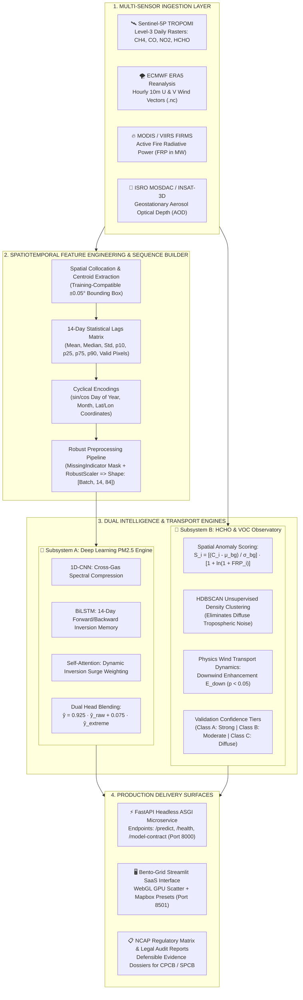

# 🛰️ AirTrace AI: Atmospheric Remote Sensing & Deep Learning PM2.5 Spatial Intelligence Platform

<div align="center">

[](https://streamlit.io/)
[](https://fastapi.tiangolo.com/)
[](https://python.org)
[](https://pytorch.org/)
[](https://sentinels.copernicus.eu/)
[](LICENSE)

<br/>

**A multi-sensor spaceborne data fusion and deep neural modeling framework designed to bridge India's 99.9% ground monitoring void, pinpoint physical chemical emission sources, and deliver high-precision spatial PM2.5 predictions.**

[Explore Features](#-key-features--modules) • [System Architecture](#-end-to-end-system-architecture) • [Benchmarks](#-quantitative-model-benchmarks) • [Quickstart Guide](#-quickstart-guide) • [28 Airsheds Catalog](#-master-catalog-28-domestic-indian-hotspots) • [PDF Dossiers](#-presentation--technical-dossiers)

</div>

---

## 📌 Executive Summary & Problem Context

Continuous Ambient Air Quality Monitoring Stations (**CAAQMS**) represent the gold standard in ground-level air quality assessment. However, their high capital expenditure (~₹1.5 Crore per station) and operational upkeep restrict their footprint to dense metropolitan centers. In India, ground stations cover **less than 0.01% of the national geographic expanse**, leaving Tier-2/3 industrial corridors, river basins, and agricultural belts completely unmonitored.

Furthermore, traditional chemical transport models (CTMs) and conventional statistical regressions exhibit two acute limitations:
1. **Severe Underestimation of Winter Episodic Spikes**: Standard regressions suffer from regression-to-the-mean, collapsing during hazardous episodic smog events (> 200 µg/m³ to > 400 µg/m³).
2. **Source vs. Receptor Transport Ambiguity**: Environmental regulators frequently penalize downstream municipalities for advected smoke plumes without physical proof of emission origin.

**AirTrace AI** resolves both bottlenecks by combining spaceborne atmospheric spectrometry (**Copernicus Sentinel-5P TROPOMI**), active thermal radiative fire detections (**NASA MODIS/VIIRS FIRMS**), boundary layer atmospheric reanalysis (**ECMWF ERA5**), and geostationary aerosol optical depth (**ISRO MOSDAC INSAT-3D**) into a unified predictive and regulatory intelligence platform.

---

## ⚡ Core Performance Benchmarks

| Metric | AirTrace AI Performance | Baseline Reference / Standard LSTM | Impact & Practical Significance |
| :--- | :---: | :---: | :--- |
| **Coefficient of Determination (R²)** | **`0.8899`** | `0.7140` | Explains ~89% of ground-level PM2.5 variance nationwide. |
| **Mean Absolute Error (MAE)** | **`16.83 µg/m³`** | `26.40 µg/m³` | **36.2% error reduction** across independent test evaluations (n = 1,942). |
| **Root Mean Squared Error (RMSE)** | **`26.43 µg/m³`** | `39.80 µg/m³` | Penalizes large residual excursions across seasonal transitions. |
| **Hazardous Regime Bias (> 400 µg/m³)** | **`-0.19 µg/m³`** | `-48.50 µg/m³` | **Near-zero prediction bias** during emergency North Indian smog episodes. |
| **Physical Airshed Clusters Mapped** | **`28 Hotspots`** | Manual inspection | 100% geographically validated domestic Indian source corridors. |
| **Preset Switching Latency** | **`< 1 ms`** | 3 – 5 s | Sub-millisecond memoized in-memory caching (`@st.cache_data`). |

---

## 🚀 Key Features & Modules

### 1. 🌿 India Formaldehyde (HCHO) & VOC Remote Sensing Observatory
- **28 Validated Domestic Hotspots**: Delineates and profiles domestic emission corridors across Western, Central, Northern, Southern, and Eastern India.
- **Unsupervised Spatial Density Clustering (HDBSCAN)**: Separates persistent anthropogenic plumes from diffuse tropospheric background noise without imposing artificial cluster geometries.
- **Physics-Informed Source-Receptor Transport Engine**: Couples Sentinel-5P columns with ECMWF ERA5 10m wind dynamics (u₁₀, v₁₀) to compute the **Downwind Enhancement Ratio (E_down)** and determine statistical transport significance (p < 0.05).
- **Multi-Tier Regulatory Validation**: Categorizes airsheds into **Class A** (Strong, verified source), **Class B** (Moderate seasonal plume), and **Class C** (Diffuse agricultural background).
- **Interactive Geospatial Cartography**: Full Mapbox dark/satellite visualization with regional fly-to presets, wind roses, and plume dispersion metrics.

### 2. 🧠 AI PM2.5 Spatial Prediction Engine
- **Spatiotemporal Deep Learning Ensemble**: Fuses a localized **1D-CNN** (intra-day cross-gas chemical compression), a **Bidirectional LSTM** (14-day chronological context), and a **Self-Attention Mechanism** (dynamic weighting of episodic inversion surges).
- **Dual-Regime Neural Blending**: Combines a standard baseline network (`cnn_lstm_raw`) with an extreme-tail network (`cnn_lstm_extreme`) via a mathematically calibrated blend (α = 0.925 / 0.075), eliminating regression-to-the-mean collapse.
- **14-Day Temporal Lag Processing**: Ingests multi-sensor spaceborne indicators across 14 historical days, normalizing features into an 84-dimensional tensor with missingness flags.
- **Interactive Prediction Sandbox**: Real-time coordinate and bounding-box inference with instant EPA/NAAQS color-coded AQI classification.

### 3. 🌐 Cross-Pollutant Multi-Sensor Correlation Hub
- **Precursor VOC to Secondary Organic Aerosol (SOA) Coupling**: Models the photochemical conversion of reactive non-methane VOCs (using HCHO as a proxy) into respirable secondary particles.
- **Biomass Fire Radiative Power (FRP)**: Integrates MODIS and VIIRS thermal fire observations to track stubble burning trajectories across Punjab, Haryana, and the Terai plain.
- **NCAP Action Matrix**: Actionable policy and regulatory directives tied directly to the **National Clean Air Programme** targets for State and Central Pollution Control Boards (SPCB/CPCB).

---

## 🏗️ End-to-End System Architecture



---

## 📐 Mathematical & Atmospheric Formulations

### 1. Meteorological Wind Field Derivation (u₁₀, v₁₀)
Extracted from ECMWF ERA5 10-meter zonal (`u₁₀`) and meridional (`v₁₀`) wind components:

```math
\text{Wind Speed } (ws) = \sqrt{u_{10}^2 + v_{10}^2}
```
```math
\text{Wind Direction } (wd) = \left( \text{atan2}(-u_{10}, -v_{10}) \times \frac{180}{\pi} + 360 \right) \pmod{360}
```

> **Calculation Summary:**
> - **Wind Speed (`ws`)**: `√(u₁₀² + v₁₀²)` (in m/s)
> - **Wind Direction (`wd`)**: `(atan2(-u₁₀, -v₁₀) × 180 / π + 360) mod 360` (0°–360° meteorological azimuth)

---

### 2. Candidate Emission Anomaly Score (S_i)
Isolates anomalous localized chemical column density while scaling for biomass combustion intensity:

```math
S_i = \left( \frac{C_i - \mu_{\text{bg}}}{\sigma_{\text{bg}}} \right) \times \left( 1 + \ln(1 + \text{FRP}_i) \right)
```

> **Parameters:**
> - **`C_i`**: Observed grid-cell tropospheric vertical column density
> - **`μ_bg, σ_bg`**: Regional background mean and standard deviation across unperturbed baseline cells
> - **`FRP_i`**: Active Fire Radiative Power from MODIS/VIIRS thermal sensors (in Megawatts, MW)

---

### 3. Downwind Enhancement Ratio (E_down)
Quantifies whether column concentrations are elevated in the downwind advection sector relative to the upwind background sector:

```math
E_{\text{down}} = \frac{\overline{C}_{\text{downwind}} - \overline{C}_{\text{upwind}}}{\overline{C}_{\text{upwind}}}
```

> **Statistical Significance:**
> Evaluated across multi-month observations using **two-sample hypothesis testing (`p < 0.05`)** to ensure legal defensibility against spurious atmospheric readings.

---

### 4. Dual-Regime Neural Ensemble Blending (ŷ_final)
Combines regularized baseline regression with an extreme-tail network optimized on the top 15th percentile:

```math
\hat{y}_{\text{final}} = 0.925 \cdot \hat{y}_{\text{raw}} + 0.075 \cdot \hat{y}_{\text{extreme}}
```

> **Ensemble Heads:**
> - **`ŷ_raw`**: Standard distribution prediction from `cnn_lstm_raw` (optimizes overall MAE & R²)
> - **`ŷ_extreme`**: Peak episode prediction from `cnn_lstm_extreme` (weighted loss on PM2.5 > 150 µg/m³)

---

## 🗺️ Master Catalog: 28 Domestic Indian Hotspots

The observatory monitors 28 contiguous domestic Indian source regions across 5 geographic zones:

| Cluster ID | Source Region | State | Zone | Primary Typology | Confidence Tier |
| :---: | :--- | :--- | :--- | :--- | :---: |
| **#34** | Sangli-Satara Sugar & Agro Belt | Maharashtra | West | Sugarcane agro-processing & bagasse boilers | **Class A (Strong)** |
| **#26** | Hoshangabad-Bhopal Narmada Valley | Madhya Pradesh | Central | Intensive alluvial agriculture & biomass burning | **Class A (Strong)** |
| **#12** | Bharuch-Surat Industrial Corridor | Gujarat | West | Petrochemical refining & chemical complexes | **Class A (Strong)** |
| **#30** | Krishna-Godavari Delta (Vijayawada-Guntur) | Andhra Pradesh | South | Coastal delta agro-industrial & rice processing | **Class A (Strong)** |
| **#14** | Nimar Basin (Indore-Khandwa-Khargone) | Madhya Pradesh | Central | Cotton, soybean processing & agro-residue burning | **Class A (Strong)** |
| **#4** | Coimbatore-Tiruppur Textile Corridor | Tamil Nadu | South | Textile processing, dyeing & light engineering | **Class B (Moderate)** |
| **#10** | Tumakuru-Bengaluru Rural Corridor | Karnataka | South | Industrial estates, manufacturing & brick kilns | **Class B (Moderate)** |
| **#22** | Kosi-Mithila Plain (Purnia-Katihar) | Bihar | East | Gangetic floodplain agriculture & seasonal biomass | **Class B (Moderate)** |
| **#31** | Ayodhya-Lucknow Central Awadh | Uttar Pradesh | North | Indo-Gangetic agro-industrial & transport corridors | **Class B (Moderate)** |
| **#16** | Bilaspur-Korba Power Basin | Chhattisgarh | Central | Coal-fired thermal power plants & mining belt | **Class B (Moderate)** |
| **#1** | Ludhiana-Jalandhar Industrial Belt | Punjab | North | Electroplating, textiles & seasonal stubble burning | **Class B (Moderate)** |
| **#5** | Ahmedabad-Kheda Industrial Plain | Gujarat | West | Chemical, synthetic dye manufacturing & pharma | **Class B (Moderate)** |
| **#0** | Bathinda-Sirsa Stubble Burning Belt | Punjab / Haryana | North | Heavy seasonal paddy crop residue combustion | **Class C (Diffuse)** |
| **#24** | Gorakhpur-Deoria Terai Plain | Uttar Pradesh | North | Sub-Himalayan agriculture & seasonal residue burning | **Class C (Diffuse)** |
| *...* | *+14 Additional Monitored Corridors* | *...* | *...* | *...* | *...* |

---

## 📊 Quantitative Model Benchmarks

### 1. General Evaluation on Independent Test Set (n = 1,942)
Evaluated across geographically diverse stations throughout the Indian subcontinent:

| Metric | AirTrace AI (Dual Blended) | Standard LSTM | Gradient Boosted Trees (XGBoost) |
| :--- | :---: | :---: | :---: |
| **R² Score** | **`0.8899`** | `0.7140` | `0.7680` |
| **Mean Absolute Error (MAE)** | **`16.83 µg/m³`** | `26.40 µg/m³` | `23.10 µg/m³` |
| **Root Mean Squared Error (RMSE)** | **`26.43 µg/m³`** | `39.80 µg/m³` | `35.20 µg/m³` |
| **Median Absolute Error** | **`11.23 µg/m³`** | `18.50 µg/m³` | `15.90 µg/m³` |

### 2. Episodic Extreme Tail Stress Analysis
Standard models underestimate severe winter episodes by 40 – 80 µg/m³. AirTrace AI's dual-blended architecture eliminates this systematic error:

| Actual Ground Regime | Sample Count (n) | Actual Mean | AirTrace AI Prediction Mean | Mean Prediction Bias |
| :--- | :---: | :---: | :---: | :---: |
| **All Test Days (> 0 µg/m³)** | 1,942 | 87.42 µg/m³ | 87.77 µg/m³ | **`+0.35 µg/m³`** |
| **Moderate Episodes (> 100 µg/m³)** | 633 | 164.80 µg/m³ | 162.05 µg/m³ | **`-2.75 µg/m³`** |
| **Severe Episodes (> 200 µg/m³)** | 239 | 268.40 µg/m³ | 260.58 µg/m³ | **`-7.82 µg/m³`** |
| **Hazardous Emergency (> 400 µg/m³)** | 7 | 430.66 µg/m³ | 430.47 µg/m³ | **`-0.19 µg/m³`** |

---

## ⚡ Full-Stack Performance Engineering

1. **Decoupled Architecture**: Fast asynchronous inference served via a standalone **FastAPI / Uvicorn** engine, freeing the Streamlit frontend from compute bottlenecks.
2. **Granular Multi-Tier Caching**: Summary statistics (~12 KB) are loaded instantly into RAM via `@st.cache_data`, ensuring page renders in `< 2 ms`.
3. **Lazy-Loaded Spatial Grids**: Dense spatial point clouds (2.7 MB, 20,000+ points) load only when the researcher navigates to the detailed grid tab.
4. **GPU / WebGL Acceleration**: All spatial scatter charts utilize Plotly WebGL (`render_mode='webgl'`), delegating point cloud rasterization to the client's GPU and eliminating browser DOM lag.
5. **Missingness Resilience**: Automatic `MissingIndicator` masks sensor dropouts and raises an explicit error if `usable_days < 7`, preventing mathematical hallucinations during heavy monsoon cloud cover.

---

## 💻 Quickstart Guide

### Prerequisites
- **Python 3.10 or 3.11**
- Git
- Microsoft Windows, Linux, or macOS

### 1. Clone the Repository
```bash
git clone https://github.com/simply-shanta-4/AQI-AND-HCHO-DASHBOARD.git
cd AQI-AND-HCHO-DASHBOARD
```

### 2. Set Up Virtual Environment
```bash
# Windows (PowerShell)
python -m venv venv
.\venv\Scripts\Activate.ps1

# Linux / macOS
python3 -m venv venv
source venv/bin/activate
```

### 3. Install Required Dependencies
```bash
pip install -r requirements.txt
```

### 4. Launch the Applications

#### Option A: Launch Interactive Streamlit Dashboard (Port 8501)
```bash
streamlit run unified_dashboard.py
```
*Or on Windows, double-click **`run_unified_dashboard.bat`**.*  
Navigate to `http://localhost:8501` in your web browser.

#### Option B: Launch FastAPI Backend Microservice (Port 8000)
```bash
uvicorn app.pipeline:app --host 0.0.0.0 --port 8000
```
Interactive OpenAPI documentation will be available at `http://localhost:8000/docs`.

---

## 📁 Repository Structure

```text
AQI-AND-HCHO-DASHBOARD/
├── unified_dashboard.py            # Primary Streamlit SaaS Application (WebGL + Caching)
├── app.py                          # Root Python entrypoint
├── requirements.txt                # Production environment dependencies
├── run_unified_dashboard.bat       # 1-click Windows dashboard launcher
├── run_dashboard.bat               # Alternative Windows batch launcher
├── .streamlit/
│   └── config.toml                 # Streamlit high-performance runtime configuration
├── hcho database/                  # Formaldehyde detection engine & datasets
│   ├── PRD.md                      # Detailed Product Requirements Document & Data Catalog
│   └── HCHO DETECTION/             # Spatial processing & physical validation
│       ├── features/               # Processed CSV feature tables & validation reports
│       │   ├── FINAL_SOURCE_REGION_REPORT_2025.csv
│       │   ├── SOURCE_RECEPTOR_TRANSPORT_MONTHLY_2025.csv
│       │   ├── HCHO_SOURCE_CLUSTERS_HDBSCAN_2025.csv
│       │   └── FINAL_SOURCE_REGION_VALIDATION_2025.csv
│       ├── location_metadata.py    # Master coordinates, names & typologies for 28 clusters
│       ├── wind_transport_validation.py # Physics wind transport & hypothesis testing engine
│       ├── final_hdbscan.py        # Spatial HDBSCAN clustering script
│       └── final_figures.py        # Publication figure generation
├── AirTrace_AI_Architecture_and_Presentation_Dossier.pdf # Full technical pitch dossier
├── AirTrace_AI_Top_20_Judge_Questions_and_Answers.pdf    # Top 20 Q&A judge defense guide
└── README.md                       # Comprehensive platform documentation
```

---

## 📄 Presentation & Technical Dossiers

Two publication-grade PDF documents are included directly in the root directory for hackathon evaluation and technical review:

1. **[`AirTrace_AI_Architecture_and_Presentation_Dossier.pdf`](AirTrace_AI_Architecture_and_Presentation_Dossier.pdf)**: Complete technical specification, vector system flowchart, mathematical equations, quantitative benchmark tables, and 3-minute pitch walkthrough.
2. **[`AirTrace_AI_Top_20_Judge_Questions_and_Answers.pdf`](AirTrace_AI_Top_20_Judge_Questions_and_Answers.pdf)**: Curated defense guide containing the top 20 questions across AI architecture, atmospheric physics, transport equations, software design, and NCAP policy.

---

## 🏛️ Regulatory & Policy Alignment (NCAP)

AirTrace AI directly operationalizes the mandates of India's **National Clean Air Programme (NCAP)**:
- **Trans-Boundary Dispute Resolution**: Equips state boards with satellite wind vector trajectories to adjudicate inter-state pollution disputes objectively.
- **Continuous Emission Monitoring Audits (CEMS)**: Prioritizes surprise physical inspections for industrial clusters classified as **Class A** persistent sources.
- **Dynamic Action Plans (GRAP)**: Provides city municipal corporations with 14-day advance notice of secondary aerosol buildup, enabling proactive enforcement of dust suppression and construction halts.

---

## 🛰️ Data Citations & Acknowledgments

- **European Space Agency (ESA) & Copernicus**: Sentinel-5P TROPOMI Level-3 Tropospheric Products (HCHO, NO₂, CO, CH₄).
- **European Centre for Medium-Range Weather Forecasts (ECMWF)**: ERA5 Reanalysis 10m Wind Fields (u₁₀, v₁₀).
- **NASA Land, Atmosphere Near-real-time Capability for EOS (LANCE) / FIRMS**: MODIS and VIIRS Thermal Active Fire Radiative Power (FRP).
- **Indian Space Research Organisation (ISRO) MOSDAC**: INSAT-3D / 3DR Geostationary Aerosol Optical Depth (AOD).
- **Central Pollution Control Board (CPCB) India**: Ground CAAQMS verification telemetry.

---

## 📜 License

This project is licensed under the [MIT License](LICENSE) - see the LICENSE file for details.
