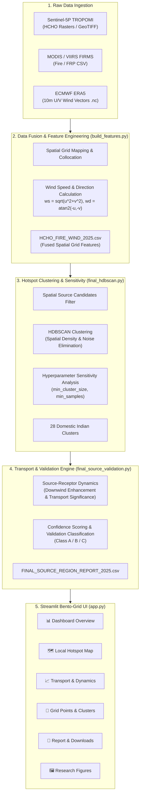

# Product Requirements Document (PRD)
## India HCHO Trace Observatory: Atmospheric Formaldehyde & Source-Receptor Transport Platform

---

### Document Information
- **Document Version**: 1.0.0
- **Status**: Approved / Operational Baseline
- **Target Year**: 2025–2026
- **Domain**: Atmospheric Remote Sensing, Geospatial Machine Learning, Environmental Regulation, Climate Tech
- **Primary Stakeholders**: Central & State Pollution Control Boards (CPCB/SPCB), Atmospheric & Climate Researchers, Environmental Policy Analysts, Industrial ESG Compliance Teams

---

## 1. Executive Summary & Problem Statement

### 1.1 Background
Formaldehyde ($\text{HCHO}$) is a key short-lived intermediate product resulting from the oxidation of non-methane volatile organic compounds (NMVOCs). It serves as a primary satellite proxy for reactive VOC emissions and is a direct precursor to toxic tropospheric ozone ($\text{O}_3$) and secondary organic aerosol (SOA) formation. 

Across India, $\text{HCHO}$ emissions arise from a complex interplay of sources:
- **Agro-Biomass Burning**: Post-harvest seasonal residue combustion (e.g., paddy straw in the Indo-Gangetic Plain, sugarcane trash in Maharashtra, cotton/maize residues in Central India).
- **Industrial & Petrochemical Hubs**: Refineries, synthetic chemical synthesizers, textile dyeing clusters, and fertilizer units (e.g., Gujarat Petrochemical Corridor, Noyyal Basin).
- **Energy & Combustion**: Coal-fired thermal power plants, brick kilns, and urban vehicular exhaust.
- **Biogenic & Forest Activity**: Isoprene and terpene emissions from tropical and deciduous forest canopies.

### 1.2 The Core Challenge
Satellite column observations alone (e.g., Sentinel-5P TROPOMI) aggregate total vertical column densities. Without integrating wind dynamics and active fire radiative signatures, it is challenging to distinguish between:
1. **True Emission Sources**: Primary points of active chemical release.
2. **Downwind Transport Receptors**: Downwind areas experiencing high $\text{HCHO}$ concentrations due to advection and secondary photochemical production rather than localized emissions.

### 1.3 The Solution
The **India HCHO Trace Observatory** is an end-to-end data pipeline and interactive analytics dashboard that integrates multi-sensor satellite imagery (Copernicus Sentinel-5P TROPOMI), thermal fire radiative power (MODIS/VIIRS FRP), and meteorological reanalysis (ECMWF ERA5 wind dynamics). Using unsupervised density-based clustering (**HDBSCAN**) and a quantitative **Source-Receptor Transport Model**, the platform identifies, validates, and ranks **28 distinct domestic Indian hotspot clusters** across key agro-industrial corridors.

---

## 2. Goals and Non-Goals

### 2.1 Goals
- **Multi-Sensor Data Fusion**: Harmonize satellite-derived $\text{HCHO}$ tropospheric columns with active fire FRP points and ERA5 10-meter wind vectors at monthly time steps.
- **Feature Engineering**: Derive meteorological wind directions, wind velocity magnitudes, localized anomaly scores, and directional transport indices.
- **Unsupervised Spatial Clustering (HDBSCAN)**: Group contiguous anomalous grid cells into coherent geographic clusters while filtering atmospheric background noise.
- **Quantitative Transport Validation**: Formulate an automated scoring pipeline that quantifies downwind plume enhancement, evaluates statistical transport significance ($p$-values), and assigns confidence validation tiers (Class A, Class B, Class C).
- **Interactive Bento-Grid SaaS UI**: Provide an intuitive web interface for geospatial mapping, time-series analysis, cluster inspection, and publication-ready report exports.

### 2.2 Non-Goals
- Real-time sub-hourly sensor telemetry (bounded by satellite orbit revisit cycles).
- Direct automated regulatory enforcement without ground-truth verification.
- Full 3D Eulerian chemical transport modeling (e.g., WRF-Chem/GEOS-Chem).

---

## 3. User Personas

| Persona | Role | Key Objectives | Core Use Case |
| :--- | :--- | :--- | :--- |
| **Dr. Priya Sharma** | Atmospheric Scientist / Academic | Validated source attribution, downwind transport statistics, raw CSV export | Publish peer-reviewed studies on VOC transport dynamics in the Indo-Gangetic Plain. |
| **Rajesh Varma** | SPCB / CPCB Regulatory Officer | Cluster ranking, seasonal emission peaks, district-level breakdown | Identify non-compliant industrial zones and target ground-level air sampling campaigns. |
| **Ananya Sen** | ESG & Climate Risk Analyst | Year-round trend tracking, fire vs. industrial attribution | Audit regional corporate environmental impact in petrochemical hubs (e.g., Bharuch-Surat). |

---

## 4. System Architecture & Data Pipeline

---

## 5. Mathematical Formulations & Algorithms

### 5.1 Wind Dynamics Calculation
Meteorological wind direction ($0^\circ = \text{North}, 90^\circ = \text{East}, 180^\circ = \text{South}, 270^\circ = \text{West}$) and magnitude are computed from zonal ($u_{10}$) and meridional ($v_{10}$) wind components:

$$\text{Wind Speed} = \sqrt{u_{10}^2 + v_{10}^2}$$

$$\text{Wind Direction (deg)} = \left(\text{degrees}\left(\text{atan2}(-u_{10}, -v_{10})\right) + 360\right) \pmod{360}$$

### 5.2 Source Candidate Score & Downwind Enhancement
For each candidate grid cell $i$, source score $S_i$ is formulated as a function of the local concentration anomaly relative to regional background $\mu_{\text{bg}}$ normalized by the local dispersion factor:

$$S_i = \frac{C_i - \mu_{\text{bg}}}{\sigma_{\text{bg}}} \times \left(1 + \log(1 + \text{FRP}_i)\right)$$

The **Downwind Enhancement Ratio ($E_{\text{down}}$)** evaluates the gradient between downwind receptor cells and upwind background cells along the mean wind vector $\vec{w}$:

$$E_{\text{down}} = \frac{\overline{C}_{\text{downwind}} - \overline{C}_{\text{upwind}}}{\overline{C}_{\text{upwind}}}$$

### 5.3 Cluster Validation Classification
Clusters are classified into three validation tiers based on composite source score, persistence, and transport significance:
* **Class A (Strong Confidence)**: High source score, cluster persistence $\ge 0.70$, statistically significant downwind enhancement ($p < 0.05$).
* **Class B (Moderate Confidence)**: Intermediate source score, moderate persistence ($0.40 \le \text{persistence} < 0.70$).
* **Class C (Weak / Diffuse)**: Lower persistence, transient agricultural fire peaks, or diffuse regional background.

---

## 6. Functional Requirements

### 6.1 Data Processing & Ingestion (`build_features.py`)
- **FR-1.1**: Ingest monthly Sentinel-5P GeoTIFF rasters across Indian coordinates ($6^\circ\text{N} - 38^\circ\text{N}, 68^\circ\text{E} - 98^\circ\text{E}$).
- **FR-1.2**: Ingest and spatially associate MODIS/VIIRS FIRMS CSV records.
- **FR-1.3**: Extract and interpolate ERA5 NetCDF $u_{10}, v_{10}$ wind vectors to match satellite grid centers.
- **FR-1.4**: Output unified dataset `features/HCHO_FIRE_WIND_2025.csv`.

### 6.2 Clustering & Sensitivity Engine (`final_hdbscan.py`, `hdbscan_sensitivity.py`)
- **FR-2.1**: Filter candidate cells using percentile-based spatial thresholds.
- **FR-2.2**: Execute HDBSCAN clustering to delineate spatially continuous emission clusters.
- **FR-2.3**: Conduct hyperparameter sensitivity sweeps across `min_cluster_size` and `min_samples`.
- **FR-2.4**: Generate cluster summary tables and spatial boundary files.

### 6.3 Transport & Validation Engine (`final_source_validation.py`, `transport_significance.py`)
- **FR-3.1**: Compute directional plume enhancements for each cluster on a monthly basis.
- **FR-3.2**: Execute hypothesis testing to verify source-receptor transport significance.
- **FR-3.3**: Produce master validation matrix `FINAL_SOURCE_REGION_REPORT_2025.csv`.

### 6.4 User Interface & Visual Analytics (`app.py`)
The user interface is structured into six dedicated modules:

1. **📊 Dashboard Overview**:
   - Executive Bento-Grid cards with key metrics (Total Clusters, Mean Source Score, Top Hotspot, Validation Breakdown).
   - Top Ranked Source Regions leaderboard.
   - Monthly temporal dynamics chart.
2. **🗺️ Local Hotspot Map**:
   - Interactive OpenStreetMap integration with zoomable cluster points.
   - Dynamic marker scaling based on source strength and color-coded validation tiers.
3. **📈 Transport & Dynamics**:
   - Scatter plots of downwind enhancement vs. wind speed.
   - Polar wind roses and monthly transport variation matrices.
4. **🔬 Grid Points & Clusters**:
   - Cluster-level drill-down for detailed grid-cell analysis.
   - Spatial candidate inspection and noise cell filter diagnostics.
5. **📑 Report & Downloads**:
   - Multi-parameter filter panel (State, Zone, Validation Class).
   - Instant CSV export for filtered datasets and complete validation reports.
6. **🖼️ Research Figures**:
   - High-resolution gallery displaying publication-ready figures (`FINAL_SOURCE_REGION_MAP_2025.png`, `FINAL_DOWNWIND_ENHANCEMENT_2025.png`, etc.).

---

## 7. Master Hotspot Catalog (28 Domestic Indian Source Regions)

| Cluster ID | Region Name | State | Zone | Primary Typology |
| :---: | :--- | :--- | :--- | :--- |
| **#34** | Sangli-Satara Sugar & Agro Belt | Maharashtra | West Zone | Sugarcane Agro-Industrial Belt |
| **#26** | Hoshangabad-Bhopal Narmada Valley | Madhya Pradesh | Central Zone | Narmada Alluvial Crop Belt |
| **#12** | Bharuch-Surat Industrial Corridor | Gujarat | West Zone | Petrochemical & Chemical Hub |
| **#30** | Krishna-Godavari Delta (Vijayawada-Guntur) | Andhra Pradesh | South Zone | Coastal Delta Agro-Industrial |
| **#14** | Nimar Basin (Indore-Khandwa-Khargone) | Madhya Pradesh | Central Zone | Cotton & Soybean Agro-Belt |
| **#4** | Coimbatore-Tiruppur Textile Corridor | Tamil Nadu | South Zone | Textile, Dyeing & Engineering Hub |
| **#10** | Tumakuru-Bengaluru Rural Corridor | Karnataka | South Zone | Industrial Estates & Brick Kilns |
| **#22** | Kosi-Mithila Plain (Purnia-Katihar) | Bihar | East Zone | Gangetic Floodplain Agriculture |
| **#31** | Ayodhya-Lucknow Central Awadh | Uttar Pradesh | North Zone | Indo-Gangetic Agro-Industrial |
| **#5** | Ahmedabad-Kheda Industrial Plain | Gujarat | West Zone | Chemical, Engineering & Textile |
| **#13** | Raipur-Durg Industrial Basin | Chhattisgarh | East Zone | Steel, Sponge Iron & Power Hub |
| **#11** | Nashik-Malegaon Agro-Corridor | Maharashtra | West Zone | Grape, Onion & Agro-Processing |
| **#15** | Sambalpur-Jharsuguda Industrial Corridor | Odisha | East Zone | Thermal Power & Aluminium Smelting |
| **#2** | North Interior Karnataka (Belagavi-Bagalkot) | Karnataka | South Zone | Sugarcane & Sugar Mills Belt |
| **#3** | Cuddalore-Nagapattinam Coastal Belt | Tamil Nadu | South Zone | Chemical Industries & Coastal Agro |
| **#27** | Gwalior-Chambal Basin | Madhya Pradesh | Central Zone | Mustard Belt & Brick Kilns |
| **#20** | Jalgaon-Dhule Tapi Valley | Maharashtra | West Zone | Banana, Cotton & Agro-Processing |
| **#1** | Ludhiana-Jalandhar Industrial & Agro Belt | Punjab | North Zone | Textile, Engineering & Stubble Burning |
| **#19** | Bareilly-Rohilkhand Plain | Uttar Pradesh | North Zone | Sugar Mills, Agro-Waste & Kilns |
| **#25** | Sagar-Damoh Bundelkhand Plateau | Madhya Pradesh | Central Zone | Wheat/Pulses Agro-Waste |
| **#16** | Bilaspur-Korba Power Basin | Chhattisgarh | East Zone | Coal Mining & Thermal Power Hub |
| **#28** | Prayagraj-Varanasi Eastern UP Corridor | Uttar Pradesh | North Zone | Carpet/Textile, Kilns & Agro |
| **#24** | Gorakhpur-Deoria Terai Belt | Uttar Pradesh | North Zone | Sugar Mills & Crop Burning |
| **#29** | Gaya-Nawada South Bihar Plain | Bihar | East Zone | Agro-Biomass & Rural Brick Kilns |
| **#0** | Bathinda-Sirsa Cotton-Wheat Belt | Punjab / Haryana | North Zone | Post-Harvest Stubble Burning |
| **#32** | Guwahati-Brahmaputra Valley | Assam | North-East Zone | Petrochemical & Agro-Forestry |
| **#6** | Kota-Baran Hadoti Region | Rajasthan | North Zone | Fertilizer, Chemical & Crop Belt |
| **#17** | Raiganj-Malda North Bengal Corridor | West Bengal | East Zone | Jute, Paddy & Brick Kiln Belt |

---

## 8. Non-Functional Requirements

- **Performance**: Instant filtering and chart rendering ($< 500\text{ ms}$) achieved via Streamlit caching (`@st.cache_data`).
- **Visual Design**: High-contrast, clean SaaS aesthetic featuring the *Plus Jakarta Sans* font family and Bento Grid card structures.
- **Reliability & Portability**: Fully self-contained Python architecture with cross-platform batch startup scripts (`run_dashboard.bat`).
- **Data Integrity**: Enforced coordinate validation and metadata association ensuring zero unmapped cluster rows.

---

## 9. Technology Stack

- **Application Framework**: Streamlit (Python)
- **Data Processing**: Pandas, NumPy, Xarray, Rasterio, SciPy
- **Machine Learning**: Scikit-Learn, HDBSCAN
- **Data Visualization**: Plotly Express, Plotly Graph Objects, Matplotlib, Seaborn
- **Input Data Formats**: GeoTIFF rasters, NetCDF (`.nc`), CSV

---

## 10. Roadmap & Future Enhancements

- **Phase 2 (Q3 2026)**: Multi-year trend analysis (2019–2025) to quantify the impact of National Clean Air Programme (NCAP) policies.
- **Phase 3 (Q4 2026)**: Automated daily near-real-time TROPOMI data ingestion with threshold-based SPCB alert notifications.
- **Phase 4 (2027)**: Ground-truth assimilation with Central Pollution Control Board Continuous Ambient Air Quality Monitoring Stations (CAAQMS).
